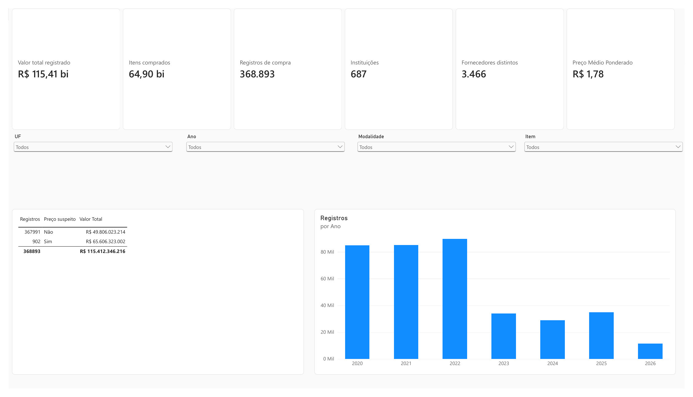
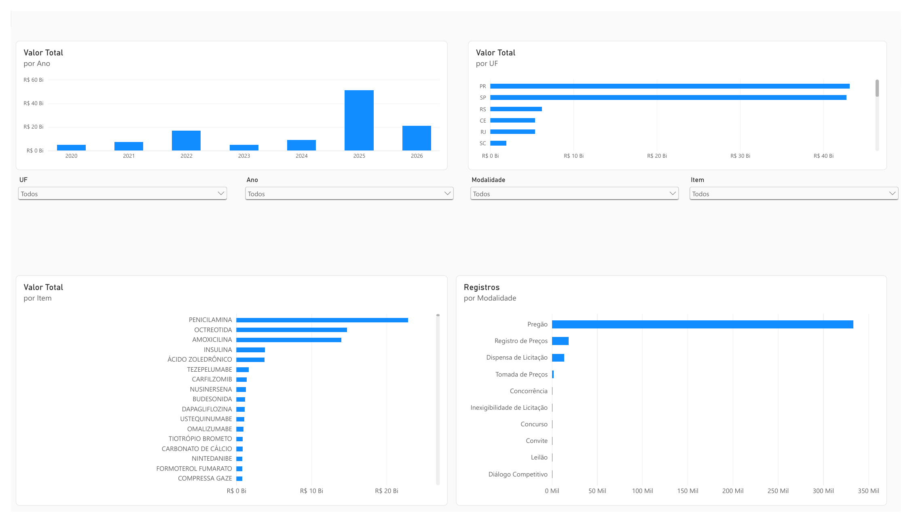
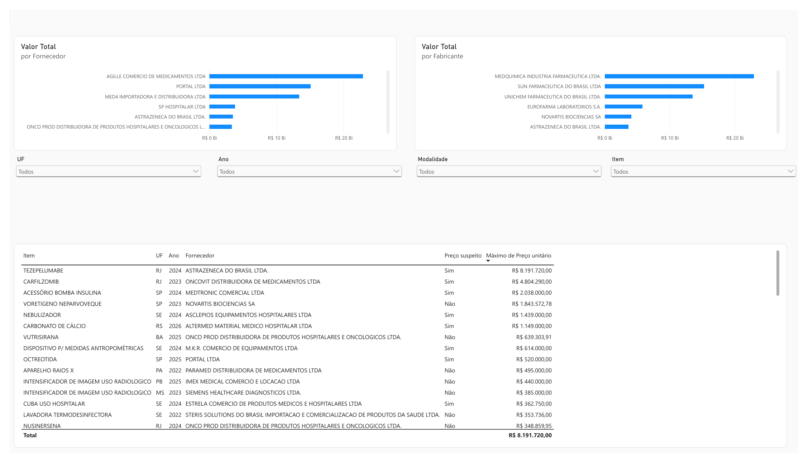

# Banco de Preços em Saúde (BPS) 2020–2026: análise e dashboard

Mini-Projeto Avaliativo do Módulo 2 do curso **Visualização de Dados e Business Intelligence** (SCTEC).
Autor: **Jandir Reis**

## Links

| Item | Link |
|---|---|
| Dashboard (Power BI, arquivo .pbix) | [powerbi/BPS_Dashboard_PowerBI_Jandir.pbix](powerbi/BPS_Dashboard_PowerBI_Jandir.pbix) |
| Dashboard (Looker Studio) | https://lookerstudio.google.com/reporting/a35ffe65-3c7d-41f6-84e6-516c3cb8dc51 |
| Base completa tratada (ZIP, 33 MB) | https://github.com/profjandirreis-sys/mini-projeto-bps-dashboard/releases/download/v1.0/BPS_20_26_Jandir.zip |
| CSV usado no dashboard (Google Drive, 94,9 MB) | https://drive.google.com/file/d/1rkP1Df1jRzzcoD_KJx1ayvr1tvPLEJIt/view?usp=sharing |
| Vídeo de apresentação (até 5 min) | [Assistir no Google Drive](https://drive.google.com/file/d/1_X9WlZ8yxCdZJx7GiESpvEpWhf65bPnr/view?usp=sharing) |

## Objetivo

Reunir as compras públicas de medicamentos e dispositivos médicos registradas no
Banco de Preços em Saúde (BPS) do Ministério da Saúde entre 2020 e 2026, tratar os
dados e construir um painel que mostre quanto se comprou, quem comprou, de quem e
onde há preços fora do padrão que merecem investigação.

## Fonte dos dados

- **Origem:** Banco de Preços em Saúde (BPS), Ministério da Saúde. Arquivos CSV anuais (separador `;`).
- **Período:** 2020 a 2026 (2026 parcial).
- **Volume:** 368.893 registros, 36 colunas iguais em todos os anos.

| Ano | Registros |
|---|---:|
| 2020 | 84.920 |
| 2021 | 85.147 |
| 2022 | 89.659 |
| 2023 | 33.874 |
| 2024 | 28.972 |
| 2025 | 34.797 |
| 2026 | 11.524 |
| **Total** | **368.893** |

## Estrutura do repositório

| Arquivo | Conteúdo |
|---|---|
| `BPS_20_26_Jandir_limpeza.ipynb` | Notebook do Google Colab com a junção, a checagem e a limpeza dos dados |
| `README.md` | Esta documentação |
| Release **v1.0** → `BPS_20_26_Jandir.zip` | Base completa tratada, compactada (33 MB) |

Os arquivos de dados passam do limite de 25 MB do envio pelo navegador do GitHub.
Por isso, o ZIP da base completa está na aba **Releases** deste repositório e o CSV
enxuto do dashboard (94,9 MB) está no Google Drive (links acima).

## Tratamento dos dados (Python / pandas, no Colab)

1. **Junção:** leitura dos 7 CSVs (UTF-8, com Latin-1 como alternativa) e concatenação
   em uma única base. Conferência: colunas iguais em todos os anos e 0 linhas duplicadas.
2. **Encoding:** correção de caracteres corrompidos (ex.: `nº` → `nº`) em `nu_processo_compra`.
3. **Datas:** `dt_compra` e `dt_insercao` convertidas para data; criada a coluna `ano_mes`.
   Nenhuma data de compra inválida e `ano_compra` coerente com a data em 100% dos casos.
4. **CNPJs:** instituição, fornecedor e fabricante padronizados com 14 dígitos (zeros à esquerda recuperados).
5. **Códigos:** `co_pdm`, `co_grupo`, `co_classe` e `registro_anvisa` sem o sufixo `.0`.
6. **Textos:** espaços removidos e campos vazios preenchidos com "Não informado".
7. **Validação de valores:** nenhum preço menor ou igual a zero, e o valor total bate com
   preço unitário × quantidade em todas as linhas.
8. **Preço suspeito:** coluna `preco_suspeito` = "Sim" quando o preço unitário passa de
   **100 vezes a mediana do mesmo item** (`co_catmat`), considerando só itens com pelo
   menos 5 compras. Resultado: **902 registros**, que somam **56,8% do valor total**.
9. **Versão para o dashboard:** criada a coluna `item_resumo` (nome curto do item), datas no
   formato `AAAAMMDD` e só as colunas usadas, para caber no Looker Studio.

## Dashboard

Feito no **Looker Studio**, em 3 páginas, com 4 filtros em todas elas: **UF, ano, modalidade e item**.

**Página 1: Visão geral (KPIs)**

| Indicador | Valor (base completa) |
|---|---:|
| Valor total registrado | R$ 115,41 bilhões |
| Itens comprados (quantidade) | 64,9 bilhões de unidades |
| Registros de compra | 368.893 |
| Instituições compradoras | 687 |
| Fornecedores | 3.466 |
| Preço unitário médio ponderado | R$ 1,78 |

**Página 2: Onde e como se compra**

- Valor registrado por ano
- Estados com maior valor registrado
- Itens com maior valor registrado
- Modalidades de compra mais registradas

**Página 3: Fornecedores, fabricantes e oportunidades**

- Fornecedores com maior valor registrado
- Fabricantes com maior valor registrado
- Tabela "Oportunidade de investigação": maiores preços unitários, com a marcação de preço suspeito

## Versão em Power BI

O mesmo painel foi refeito no **Power BI Desktop** (pasta [`powerbi/`](powerbi/)), com as mesmas 3 páginas e os mesmos 4 filtros (UF, ano, modalidade e item), sincronizados entre as páginas.

| Arquivo | Conteúdo |
|---|---|
| [`powerbi/BPS_Dashboard_PowerBI_Jandir.pbix`](powerbi/BPS_Dashboard_PowerBI_Jandir.pbix) | Relatório do Power BI Desktop |
| [`powerbi/BPS_Dashboard_PowerBI_Jandir.pdf`](powerbi/BPS_Dashboard_PowerBI_Jandir.pdf) | Exportação em PDF das 3 páginas |
| [`powerbi/prints/`](powerbi/prints/) | Imagens de cada página |
| [`powerbi/consulta_power_query.m`](powerbi/consulta_power_query.m) | Consulta Power Query (M) que lê o CSV |
| [`powerbi/medidas.dax`](powerbi/medidas.dax) | Medidas DAX dos KPIs e consulta de conferência |

**Importação:** o CSV usa ponto como separador decimal. Como o Power BI estava em português, a conversão de tipos foi feita com a cultura `en-US` (senão 0.15 viraria 15). A coluna `dt_compra` (AAAAMMDD) foi convertida em data no Power Query.

**Medidas DAX:** `Valor Total`, `Quantidade Total`, `Registros`, `Instituições`, `Fornecedores`, `Preço Médio Ponderado` e `Registros Suspeitos`. Para o cartão de KPIs mostrar os números exatos (sem o arredondamento automático do Power BI, como "3 Mil"), há também medidas de texto: `Valor total registrado`, `Itens comprados`, `Registros de compra` e `Fornecedores distintos`. As colunas usadas nos visuais foram renomeadas (UF, Ano, Modalidade, Item, Fornecedor, Fabricante, Preço suspeito, Preço unitário). Os valores conferem com o notebook e com o Looker Studio:

| KPI | Power BI (base completa) |
|---|---:|
| Valor total registrado | R$ 115.412.346.216 |
| Quantidade total | 64.901.180.479 |
| Registros | 368.893 |
| Instituições | 687 |
| Fornecedores | 3.466 |
| Preço médio ponderado | R$ 1,78 |
| Registros com preço suspeito | 902 |

**Páginas:**

1. **Visão geral:** cartão com os 6 KPIs, registros por ano e tabela de preço suspeito (902 registros que somam R$ 65,6 bi, 56,8% do valor).
2. **Onde e como se compra:** valor por ano, valor por UF, itens com maior valor e registros por modalidade.
3. **Fornecedores e oportunidades:** fornecedores e fabricantes com maior valor e tabela "Oportunidade de investigação", ordenada pelo maior preço unitário, com a marcação de preço suspeito.

## Principais achados

- **Pregão** é, de longe, a modalidade mais usada: cerca de 333 mil dos 368,9 mil registros.
- **PR e SP** lideram tanto em número de registros quanto em valor.
- **A esfera municipal** responde pela grande maioria das compras (cerca de 341 mil registros).
- **O valor total é muito concentrado:** os 10 maiores registros somam 54,5% de todo o valor.
  O maior deles (penicilina, PR, 2025) tem preço unitário de R$ 294.400, muito acima do normal
  para o item, o que indica provável erro de digitação na origem.
- Por isso, **2025 aparece como o ano de maior valor** e os totais por item ou estado devem ser
  lidos com cautela. A coluna `preco_suspeito` e o filtro de item ajudam a separar esses casos.

## Limitações

- 2026 tem dados só de parte do ano.
- Os registros do BPS são informados pelas próprias instituições, então erros de
  digitação de preço ou quantidade afetam os totais.
- A regra de "preço suspeito" é um sinal para investigar, não uma prova de irregularidade.

## Ferramentas

Google Planilhas · Google Colab (Python, pandas, NumPy) · Looker Studio · Power BI Desktop (Power Query, DAX) · GitHub

## Documentação complementar

| Documento | Conteúdo |
|---|---|
| [Perguntas de negócio](docs/01_perguntas_de_negocio.md) | Perguntas que orientaram o dashboard e onde cada uma é respondida |
| [Mapeamento de discrepâncias](docs/02_mapeamento_discrepancias.md) | Diferenças de estrutura, formato e conteúdo entre os anos, e a solução adotada |
| [Colunas e KPIs](docs/03_colunas_e_kpis.md) | Descrição das principais colunas, fórmulas dos KPIs e regras de agregação |
| [Recomendações e reprodução](docs/04_recomendacoes_e_reproducao.md) | Recomendações baseadas nos dados e passo a passo para reproduzir o projeto |

## Organização do trabalho (branches)

Cada parte da documentação foi feita em uma branch própria e integrada à `main` por pull request:

- `docs/perguntas-de-negocio`
- `docs/mapeamento-discrepancias`
- `docs/colunas-e-kpis`
- `docs/recomendacoes-e-reproducao`

## Contato

Jandir Reis

LinkedIn: https://www.linkedin.com/in/profjandirreis

E-mail: profjandirreis@gmail.com
